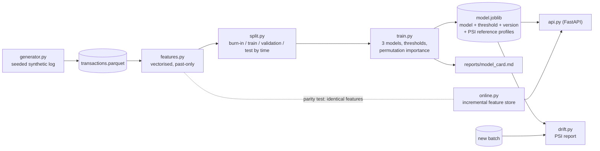

# fraud-detection-ml

[](https://github.com/rahulkumar96t/fraud-detection-ml/actions/workflows/ci.yml)

An end-to-end card-fraud detection project: a seeded synthetic transaction generator with realistic
fraud patterns, leakage-safe feature engineering (offline and online, kept in sync by a parity
test), a time-based evaluation of a linear baseline, an additive spline baseline and gradient
boosting, cost-based threshold selection, a generated model card, a FastAPI scoring service and a
PSI drift report. It is a reference implementation on synthetic data, built to show the
engineering around a fraud model: what can leak, how to evaluate it honestly, and how to serve it
with the same features it was trained on.

## Features

- **Synthetic data with structure** (`generator.py`): 2,000 cards, 400 merchants, 150 days,
  about 517k transactions at about 0.23 % fraud. Three injected patterns: card-testing bursts
  (tiny online authorisations at weak-verification merchants, then a cash-out), account takeover
  (new device, often a new country, several multiples of normal spend) and high-value fraud at
  jewellery / electronics / gift-card merchants. Legitimate look-alikes keep it from being
  trivial: travel, second devices, commuters with micro-payments, in-app purchase bursts,
  legitimate splurges.
- **Leakage-safe features** (`features.py`): per-card velocity counts over trailing 10 m / 1 h /
  24 h / 7 d windows, amount z-score and ratio against the card's own history, time since the
  last transaction, device / country change and first-seen flags, time of day, and merchant /
  category fraud rates computed only from labels that would already have arrived (3-day label
  delay, 28-day trailing window, Bayesian smoothing).
- **Time-based split** with a 31-day burn-in, so every training row has fully populated history.
- **Three models**: linear logistic regression, spline (additive, GAM-style) logistic
  regression, and `HistGradientBoostingClassifier` with early stopping on the later validation
  period. Class weighting for the imbalance.
- **Decision metrics**: PR-AUC, recall at a precision floor, precision@k, and an explicit cost
  model (review cost per alert vs. the amount of each missed fraud) used to pick the operating
  threshold on validation before it is applied to test.
- **Permutation importance** and a **generated model card** with the numbers of the actual run.
- **FastAPI service** with Pydantic schemas, an in-memory online feature store, label feedback,
  batch scoring and the model version in every response.
- **PSI drift report** against binned reference profiles stored inside the model artefact.

## Architecture



The same feature definitions exist twice: vectorised (pandas / NumPy) for training, incremental
(per-card deques and running sums) for serving. `tests/test_online_parity.py` replays a generated
log through the online store and requires every feature to match the offline value to 1e-9.

## Quickstart

Requires [uv](https://docs.astral.sh/uv/). Python 3.12 is pinned in `.python-version`.

```bash
make install    # uv sync --locked
make demo       # generate data, train, write model card + two drift reports
make test       # pytest (55 tests)
make serve      # FastAPI on 127.0.0.1:8000, card state warmed up from data/
```

## Usage

```bash
uv run fraud-ml generate --out data/transactions.parquet            # --seed, --cards, --days ...
uv run fraud-ml train --data data/transactions.parquet              # artifacts/ + reports/model_card.md
uv run fraud-ml generate --start 2026-06-01 --amount-scale 2 --fraud-multiplier 3 \
    --out data/fraud_wave.parquet                                   # same population, drifted
uv run fraud-ml drift --data data/fraud_wave.parquet --out reports/drift_fraud_wave.md
uv run fraud-ml serve --history data/transactions.parquet
```

Scoring a transaction (`explain=true` adds the computed features to the response). Card
`c00042` has history in the generated log; here it suddenly buys jewellery at 03:10 from a new
device in a new country:

```bash
curl -s -X POST 'localhost:8000/score?explain=true' -H 'content-type: application/json' -d '{
  "transaction_id": "t-1", "timestamp": "2026-06-01T03:10:00Z", "card_id": "c00042",
  "merchant_id": "m0341", "merchant_category": "jewelry", "amount": 2400,
  "country": "RO", "device_id": "unknown-1", "channel": "online"}'
```

Response from the committed model (features abbreviated):

```json
{
  "transaction_id": "t-1",
  "fraud_score": 0.9996267658491481,
  "decision": "review",
  "threshold": 0.00493911779793571,
  "model_name": "hist_gradient_boosting",
  "model_version": "hgb-511569fef2",
  "features": {"amount_zscore": 10.58, "card_tx_count_7d": 12.0, "is_night": 1.0,
               "new_device": 1.0, "new_country": 1.0, "merchant_risk": 0.0093, "...": "..."}
}
```

A routine grocery purchase on another known card (`c00043`, own device, a country it has used)
came back with `"fraud_score": 7.1e-07, "decision": "approve"`.

Other endpoints: `GET /health`, `GET /model` (version, threshold policy, test metrics),
`POST /score/batch` (up to 1,000; state is updated in time order, results come back in request
order) and `POST /feedback` (a confirmed label; it only influences merchant risk once the label
delay has passed, exactly as in training).

## Results of the committed run

Measured with `make demo` on an Apple M4 Pro (12 cores, 24 GB), Python 3.12.11, scikit-learn
1.9.1; the full run took about 70 s, training about 25 s. All numbers below are copied from
[`reports/model_card.md`](reports/model_card.md), which the training command generates. They are
results on **synthetic** data and say nothing about performance on real transactions.

| model (test period, 103k rows, 261 frauds) | PR-AUC | recall @ precision ≥ 80 % | precision@100 |
|---|---:|---:|---:|
| Logistic regression (linear) | 0.266 | 0.0 % | 0.55 |
| Logistic regression (spline / additive) | 0.681 | 47.5 % | 0.90 |
| HistGradientBoosting (selected on validation) | 0.833 | 72.8 % | 1.00 |

Operating points of the selected model, thresholds fixed on validation and applied to test:

| policy | alerts | precision | recall | cost (alerts x 5 + missed fraud amount) |
|---|---:|---:|---:|---:|
| cost-optimal threshold | 990 | 24.3 % | 92.3 % | 22,022 |
| precision ≥ 80 % threshold | 215 | 85.6 % | 70.5 % | 58,114 |
| no model / review everything | 0 / 103,093 | - | - | 138,906 / 515,465 |

The drift reports ([`drift_test_period.md`](reports/drift_test_period.md),
[`drift_fraud_wave.md`](reports/drift_fraud_wave.md)) show two things worth knowing. In the
in-distribution test period 21 of 22 monitored series are stable, but `category_risk` scores PSI
0.42: part of that is real (the apparel category's fraud rate rose), part is that quantile bins on
a feature with a dozen narrow levels flip mass between bins on tiny moves. In the simulated fraud
wave (prices x2, fraud x3) `log_amount` and the risk features move, while `amount_zscore` does not
because it is scale-free: a reminder that "inputs drifted" and "model is wrong" are different
questions.

Scoring latency inside one process (online features + `predict_proba` on a single row, 1,000
calls after replaying the 517k-row history, which took 9 s): p50 13 ms, p95 27 ms. Most of it is
DataFrame construction and scikit-learn input validation for a one-row frame; batching amortises
it. These are not HTTP measurements.

## Design decisions and trade-offs

- **Event-order semantics.** "Before t" means earlier in (timestamp, transaction_id) order. Window
  counts include earlier transactions with the same timestamp; label-based features use strictly
  earlier timestamps minus the label delay. Both paths implement exactly this, and the tests pin it.
- **Labels arrive late.** Using every label before `t` would still leak: in production a
  chargeback lands days later. Merchant / category risk therefore only sees labels older than
  `label_delay` (3 days), inside a 28-day trailing window.
- **Stationary features over cumulative ones.** An early version used all-time merchant risk and
  the card's total transaction count. Both grow with time, so the in-distribution test period
  showed PSI between 0.5 and 1.8 on those features before any real drift. They were replaced by trailing-window rates and a
  capped history count.
- **Time split, not random split.** Random splits put a card's later transactions next to its
  earlier ones and overstate performance. The first 31 days are burn-in (label delay + lookback).
- **Class weights, not resampling.** SMOTE invents transactions between real ones and breaks the
  per-card sequences the features describe. During development `class_weight="balanced"` gave a
  clearly lower validation PR-AUC for the logistic baselines than a weight of 10; the weight
  (`TrainConfig.positive_weight`) was not tuned further. Scores are therefore not calibrated
  probabilities; the API calls them `fraud_score` and ships the threshold.
- **Thresholds come from validation.** "Recall at 80 % precision" read off the test curve is an
  upper bound; the model card reports it, but the operating points use a threshold chosen on
  validation, which is what a deployment would do. The default policy minimises a simple cost
  model and alerts a lot because a review (5) is cheap next to an average fraud.
- **A fair baseline.** The plain linear model is weak here because "large amount" is only
  suspicious in combination with other signals. The spline logistic regression keeps one
  inspectable shape function per feature and is the baseline worth beating.
- **Deterministic model versions.** `hgb-<hash>` is a hash of model parameters, feature / split
  configuration and a fingerprint of the training data, so retraining the same inputs yields the
  same version.
- **Two feature implementations.** Vectorised code is fast enough to train on 500k rows in
  seconds; the online path needs per-event updates. Keeping both honest is the parity test's job.

## Testing

```bash
uv run ruff check . && uv run pytest -q
```

55 tests, about 20 s on the machine above, no network or external services:

- **Leakage**: features of the first k rows are identical when computed on a truncated log;
  rewriting every future row (amounts, labels, devices, countries, merchants) leaves past features
  untouched; flipping labels inside the delay window changes nothing, flipping matured labels
  does move merchant risk (so the test is not vacuous); hand-computed toy examples for every card
  feature and for the label delay.
- **Online / offline parity** over a full generated log.
- **Generator**: same seed gives an identical frame, different seed differs, schema, each pattern
  has its signature (bursts, unseen devices, high-value categories), drift knobs keep the
  population, fraud rate does not depend on period length.
- **Metrics / drift / split**: precision@k, recall at precision, cost-optimal threshold against
  brute force, PSI on identical / shifted / discrete data, ordered and disjoint splits.
- **Training smoke test** on a small sample: every model beats the base rate, the champion is the
  validation winner, the cost-optimal threshold beats both trivial policies, versions are
  deterministic, artefacts round-trip, the model card quotes the measured numbers.
- **API**: health / model info, versioned responses, state accumulation across calls, batch order,
  validation errors (422), label-delay behaviour of `/feedback`, warm start, out-of-order events.
- **CLI** end to end (generate, train, drift).

## Limitations and roadmap

- Synthetic data only. The model learns the generator's patterns; the numbers are a sanity check
  of the pipeline, not evidence about real fraud.
- The online store is in memory and single-process, and assumes per-card time order (late events
  are scored, with clamped gaps). A real deployment needs a shared low-latency store (for example
  Redis or a feature store), TTLs and persistence.
- Labels are assumed complete after the delay; real chargebacks trickle in for weeks.
- Hour of day is UTC, not the cardholder's local time.
- No probability calibration (isotonic on a held-out period would be the next step), no hyper-
  parameter search, no fairness analysis.
- Possible next steps: calibrated scores, a champion / challenger shadow mode in the API, PSI with
  fixed domain bins for low-cardinality features, Prometheus metrics, a Dockerfile.

## Project layout

```
src/fraud_detection/
  generator.py   synthetic transactions + fraud patterns
  features.py    offline features (vectorised) + definitions
  online.py      incremental feature store for serving
  split.py       time-based split with burn-in
  models.py      model factories
  metrics.py     PR-AUC, recall@precision, precision@k, cost model
  train.py       training pipeline, permutation importance, artefact
  model_card.py  markdown model card from the training report
  drift.py       PSI profiles and report
  api.py         FastAPI service
  cli.py         fraud-ml command
reports/         output of `make demo` (model card, drift reports)
```

## License

MIT, see [LICENSE](LICENSE).
